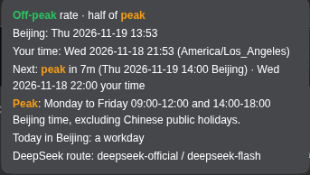

<p align="center">
  
  
</p>

# Peak Price Pal

A small sun or moon under the composer tells you when DeepSeek is charging peak or off-peak rates.

DeepSeek halves its API rates outside peak hours. The window is fixed in Beijing time, so it lands at odd hours for most of the world. This plugin puts the current state beside the context ring, where you already look, and keeps the details one hover away.

<p align="center">
  
</p>

<p align="center">
  
</p>

The first image is the real hover card at 21:53 Pacific, seven minutes before the 14:00 Beijing peak switch. The second is the composer row in the peak state, with the amber sun at the far right past the 50% context ring. The words for the current and next rate carry the same amber and green as the logo.

## What you see

- An amber sun while peak rates apply.
- A green moon while off-peak rates apply.
- Nothing at all on a third-party provider such as OpenRouter, even when the model name says DeepSeek.

Hover the logo for the full picture. The card shows your local time, Beijing time, the next switch with a countdown, the peak rule, today's status in Beijing, and the provider and model behind the reading. The words peak and off-peak carry the same amber and green as the logo.

There is no click action and no settings panel.

## The billing window

| | Beijing time |
| --- | --- |
| Peak | Monday to Friday, 09:00-12:00 and 14:00-18:00, excluding Chinese public holidays |
| Off-peak | every other hour, including every weekend and every holiday |

Off-peak is half the peak rate.

The start of a window counts exactly on the hour. So 09:00 is peak, 12:00 is off-peak, 14:00 is peak, and 18:00 is off-peak.

Weekends are off-peak all day, even when China schedules a make-up workday on a Saturday. DeepSeek makes every weekend off-peak in full, and the plugin follows that.

The official source is [Models & Pricing](https://api-docs.deepseek.com/quick_start/pricing).

## Current prices

The official list, in USD per 1M tokens, checked on 2026-11-18. Off-peak is half of the peak number.

| Model | Rate | Input, cache hit | Input, cache miss | Output |
| --- | --- | --- | --- | --- |
| `deepseek-flash` | Peak | $0.006 | $0.30 | $1.20 |
| `deepseek-flash` | Off-peak | $0.003 | $0.15 | $0.60 |
| `deepseek-v4-pro` | Peak | $0.044 | $1.32 | $3.96 |
| `deepseek-v4-pro` | Off-peak | $0.022 | $0.66 | $1.98 |

DeepSeek can change these numbers. But the plugin does not quote them. It only tells you which window is active. Check the official page before you plan a large job.

## Holidays

The peak rule excludes Chinese public holidays. The plugin carries the 2026 and 2027 off-days from the State Council's published calendar, through [holiday-cn](https://github.com/NateScarlet/holiday-cn). The [2026 notice](https://www.gov.cn/zhengce/zhengceku/202511/content_7047091.htm) and the [2027 notice](https://www.gov.cn/zhengce/zhengceku/202611/content_7085102.htm) are the primary sources.

When the clock reaches a year the plugin does not carry, it falls back to the weekday rule and says so in the hover card. A later release can add the year.

The plugin makes no network request, before or after.

## Install

You need the DeepSeek Harness, running in a browser or the desktop app.

1. Open **Plugins** in the left sidebar.
2. Press **Install**.
3. Paste the repository address:

   ```
   https://github.com/DevTarlow/dsh-peak-price-pal
   ```

4. Install it, then refresh the page.

For a local copy, paste the folder's full path instead. The install dialog accepts a GitHub address, a package name, or a local folder.

## Use

The logo is the last item in the line under the input, past the context ring. It has no click action and no settings. Hover or focus it when you want the numbers. The card stays open while the pointer rests on it, so the text can be selected and copied.

Switch the model to an OpenRouter route and the logo disappears. Switch back to a DeepSeek route and it returns. And the change lands as soon as the session's model store changes.

## Privacy

The plugin reads the current provider and model from the page and keeps the value in memory. It sends nothing, stores nothing, and makes no network request. Your session text and token counts are never read.

## Limits

- The rule is Beijing time. Your local time appears on hover for convenience, not as a second opinion.
- The logo shows the window, not your bill. It does not estimate spend.
- Prices can change. The table has the date it was checked.
- The holiday calendar covers 2026 and 2027. Later years need an update.
- A session with no readable model route shows no logo.
- Subagent sessions show no logo.

## Acknowledgements

Two projects inspired me to make Peak Price Pal.

[Peak Valley](https://github.com/blueziii/dsh-peakvalley) is the closer one. It put the same peak and off-peak state under the DSH composer, next to the context ring, and its holiday handling pointed me at the public holiday calendar. I kept the placement idea and built the sun/moon logo and the colored hover card around it. The provider gate that hides the logo on OpenRouter is my own addition.

[Price Track Buddy](https://github.com/DevTarlow/price-track-buddy) is my own GNOME Shell extension for Linux. It is where I first used the Beijing peak window and the local countdown in a tool I keep on the desktop. This plugin carries that habit into DSH.

The code here is its own. The pricing rule comes from DeepSeek's public docs. The holiday dates come from the State Council notices through [holiday-cn](https://github.com/NateScarlet/holiday-cn). The UI is built on the DSH composer dock.

## Development

The repository has no build step and no runtime dependencies.

```sh
npm test
```

The test file starts the browser module in Node with small React and react-dom stubs, then checks the time math, the holiday table, the model gate, the manifest, the locale keys, the icon, and the slot registration. Edit `client.js` and refresh the page to see the change. Edit `index.js`, `package.json`, or `cordis.patch.yml` and restart the Harness.
