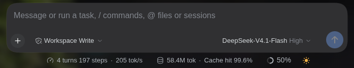

<p align="center">
  
  
</p>

# Peak Price Pal

A small sun or moon under the composer tells you when DeepSeek is charging peak or off-peak rates, and hovering it shows your balance and today's spend.

DeepSeek halves its API rates outside peak hours. The window is fixed in Beijing time, so it lands at odd hours for most of the world. This plugin puts the current state beside the context ring, where you already look, and keeps the details and your balance one hover away.

<p align="center">
  
</p>

<p align="center">
  
</p>

The first image is the real hover card at 21:53 Pacific, seven minutes before the 14:00 Beijing peak switch. The second is the composer row in the peak state, with the amber sun at the far right past the 50% context ring. The words for the current and next rate carry the same amber and green as the logo. This capture predates the balance and spend rows.

## What you see

- An amber sun while peak rates apply.
- A green moon while off-peak rates apply.
- Your balance and today's spend in the hover card, when the Harness has a DeepSeek key or a signed-in account for the route.
- Nothing at all on a third-party provider such as OpenRouter, even when the model name says DeepSeek.

Hover the logo for the full picture. The card shows your balance and today's tracked spend, your local time, Beijing time, the next switch with a countdown, the peak rule, today's status in Beijing, and the provider and model behind the reading. The words peak and off-peak carry the same amber and green as the logo.

There is no click action on the card. The settings live in the Plugins section.

## Balance and tracked spend

The card reads the DeepSeek balance for the session's route. The account route uses your DeepSeek sign-in. The official API route uses the key already saved in this Harness, `DEEPSEEK_API_KEY` or the conventional `DEEPSEEK_OFFICIAL_API_KEY`. A custom `apiKeyEnv` on the official route is not followed. There is no second key field, and the key never reaches the page.

The card shows the total, the topped-up and granted parts, how much it has tracked today, and any top-up today. It labels the daily number **Tracked today** because it can only count the drops that happened while the page was open. It also warns when the balance is too low for new calls. The amounts use the wallet currencies DeepSeek reports.

The Host reads the balance immediately when the logo appears and then once a minute while the Harness page stays open, including a background tab, as long as the balance is shown. Opening Settings reads once too. That is what makes the daily total useful. Hide the balance in settings and the reads stop. There is no background daemon and no timer after the page closes.

Today means your local calendar day, not Beijing. Spend is inferred from balance drops between consecutive readings. The ledger counts a drop only when the previous reading is from the same day and no more than 15 minutes earlier. A gap longer than 15 minutes, or a new local day, just sets a new baseline, so usage the page never saw is not blamed on today. Granted-balance expiry and a changed key can look like a drop. Treat the number as an observed total, not an invoice.

The ledger keeps eight local days and the last reading in this browser. It does not sync. The balance request goes to `api.deepseek.com`; a key for a custom DeepSeek-compatible gateway may not report a balance there.

If the key is rejected, the card says so. If no key or sign-in is available for the route, it says that instead. If the balance route is missing, the card asks for a Harness restart to load the Host half. A network failure shows unavailable and retries on the next read.

## The billing window

| | Beijing time |
| --- | --- |
| Peak | Monday to Friday, 09:00-12:00 and 14:00-18:00, excluding Chinese public holidays |
| Off-peak | every other hour, including every weekend and every holiday |

Off-peak is half the peak rate.

The start of a window counts exactly on the hour. So 09:00 is peak, 12:00 is off-peak, 14:00 is peak, and 18:00 is off-peak.

Weekends are off-peak all day, even when China schedules a make-up workday on a Saturday. DeepSeek makes every weekend off-peak in full, and the plugin follows that.

The official source is [Models & Pricing](https://api-docs.deepseek.com/quick_start/pricing).

## Current prices

The official list, in USD per 1M tokens, checked on 2026-11-18. Off-peak is half of the peak number.

| Model | Rate | Input, cache hit | Input, cache miss | Output |
| --- | --- | --- | --- | --- |
| `deepseek-flash` | Peak | $0.006 | $0.30 | $1.20 |
| `deepseek-flash` | Off-peak | $0.003 | $0.15 | $0.60 |
| `deepseek-v4-pro` | Peak | $0.044 | $1.32 | $3.96 |
| `deepseek-v4-pro` | Off-peak | $0.022 | $0.66 | $1.98 |

DeepSeek can change these numbers. But the plugin does not quote them. It only tells you which window is active. Check the official page before you plan a large job.

## Holidays

The peak rule excludes Chinese public holidays. The plugin carries the 2026 and 2027 off-days from the State Council's published calendar, through [holiday-cn](https://github.com/NateScarlet/holiday-cn). The [2026 notice](https://www.gov.cn/zhengce/zhengceku/202511/content_7047091.htm) and the [2027 notice](https://www.gov.cn/zhengce/zhengceku/202611/content_7085102.htm) are the primary sources.

When the clock reaches a year the plugin does not carry, it falls back to the weekday rule and says so in the hover card. A later release can add the year.

The holiday table is bundled, so the window math works without a request. The balance read above is the only network request the plugin makes.

## Install

You need the DeepSeek Harness, running in a browser or the desktop app.

1. Open **Plugins** in the left sidebar.
2. Press **Install**.
3. Paste the repository address:

   ```
   https://github.com/DevTarlow/dsh-peak-price-pal
   ```

4. Install it, then refresh the page. If the balance row says unavailable after an update, restart the Harness so the Host half reloads.

For a local copy, paste the folder's full path instead. The install dialog accepts a GitHub address, a package name, or a local folder.

## Use

The logo is the last item in the line under the input, past the context ring. It has no click action. Hover or focus it when you want the numbers. The card stays open while the pointer rests on it, so the text can be selected and copied. The logo reads the balance as soon as it appears in the composer, whether or not the card is open, and refreshes it once a minute while the Harness page is open. Opening Settings reads the balance once.

Switch the model to an OpenRouter route and the logo disappears. Switch back to a DeepSeek route and it returns. And the change lands as soon as the session's model store changes.

## Settings

Open **Settings > Plugins > Peak Price Pal**.

- **Icon**: the sun and moon, or a plain dot. The dot uses the same state color without a glyph.
- **Clock**: 24-hour or 12-hour. It covers the current times, the next switch, and the rule line.
- **Details**: all details, or minimal. Minimal keeps the current state and the next switch. It hides the balance rows but does not stop the reads; Hide does that.
- **Balance**: show or hide the balance and tracked-spend rows. Show reads once a minute while the Harness page is open. Hide stops the reads and the daily tracking.
- **Balance source**: a read-only line that says which credential this page checked, API key or account, and today's tracked spend for that source.
- **Reset to defaults** returns to the sun and moon, 24-hour, all details, and the balance shown.

Changes apply as soon as you pick them. The display choices are saved in this browser, so another browser starts from the defaults.

## Privacy

The plugin reads the current provider and model from the page and keeps the value in memory. It stores four display preferences, the last balance reading, and up to eight tracked daily buckets in this browser. When the logo appears and the balance is shown, the Host asks DeepSeek for the balance immediately and then once a minute, including while the tab is in the background. Opening Settings reads once. The API-key route sends the key only to `api.deepseek.com`; the account route reads the signed-in wallet through the Harness account service. The key is never returned to the page, written to settings, or put in the ledger. Your session text and token counts are never read.

## Limits

- The rule is Beijing time. Your local time appears on hover for convenience, not as a second opinion.
- The balance is the provider's current number, not an invoice. The tracked line is observed from balance drops while the page is open.
- Tracked today is per browser and per route. It does not sync, and a gap longer than 15 minutes starts a new baseline.
- The account route and the API-key route are separate billing views. The card follows the route the session uses.
- Prices can change. The table has the date it was checked.
- The holiday calendar covers 2026 and 2027. Later years need an update.
- A key for a custom DeepSeek-compatible gateway may not report a balance at `api.deepseek.com`.
- A session with no readable model route shows no logo.
- Subagent sessions show no logo.

## Acknowledgements

Two projects inspired me to make Peak Price Pal.

[Peak Valley](https://github.com/blueziii/dsh-peakvalley) is the closer one. It put the same peak and off-peak state under the DSH composer, next to the context ring, and its holiday handling pointed me at the public holiday calendar. I kept the placement idea and built the sun/moon logo and the colored hover card around it. The provider gate that hides the logo on OpenRouter is my own addition.

[Price Track Buddy](https://github.com/DevTarlow/price-track-buddy) is my own GNOME Shell extension for Linux. It is where I first used the Beijing peak window, the local countdown, and the balance ledger behind a daily spend line. This plugin carries those habits into DSH.

The code here is its own. The pricing rule comes from DeepSeek's public docs. The holiday dates come from the State Council notices through [holiday-cn](https://github.com/NateScarlet/holiday-cn). The UI is built on the DSH composer dock.

## Development

The repository has no build step and no runtime dependencies.

```sh
npm test
```

`test/client.test.mjs` starts the browser module in Node with small React, react-dom, and storage stubs, then checks the time math, the holiday table, the model gate, the settings store, the balance ledger, the manifest, the locale keys, the icons, and the slot registrations. `test/host.test.mjs` runs the balance route with a stub context and fetch and checks source selection, normalization, caching, and the owner-only contract. Edit `client.js` and refresh the page. Edit `index.js`, `package.json`, or `cordis.patch.yml` and restart the Harness.
